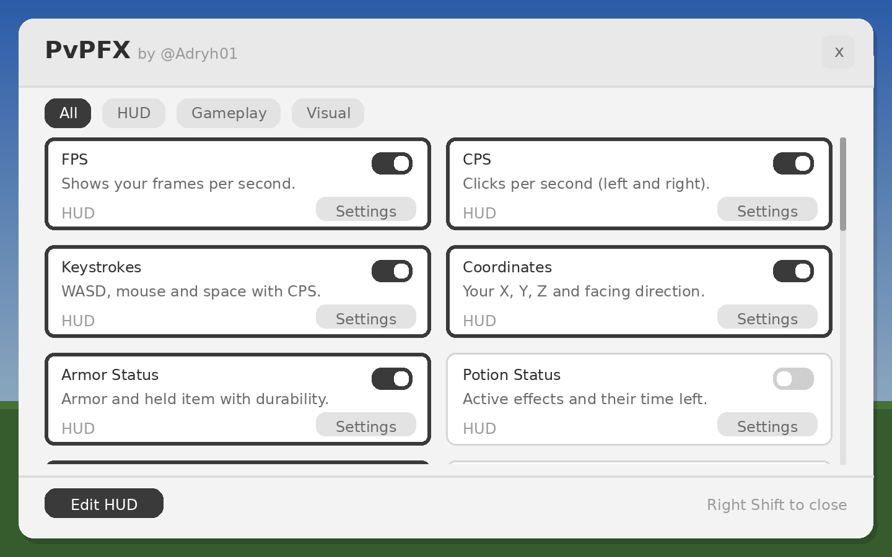

# PvPFX — by @Adryh01

Client-side Forge mod for **Minecraft 1.8.9**: a PvP client menu in the same white/grey style as SkyFX.
Press **Right Shift** to open it.

## Modules (13), each with its own settings
**HUD** (all have scale, text shadow, background and colour; drag them with *Edit HUD*)
- **FPS** — 3 text styles
- **CPS** — left / right clicks per second
- **Keystrokes** — WASD, mouse buttons with CPS, space bar; animated key press
- **Coordinates** — compact or 3 lines, decimals, facing direction
- **Armor Status** — armor + held item, durability as number or percent
- **Potion Status** — active effects with time left
- **Ping**, **Clock** (12/24h, seconds), **Reach Display** (distance of your last hit)

**Gameplay**
- **Toggle Sprint** — sprints while you hold forward, optional status text
- **Zoom** — hold **C** (rebindable), smooth zoom, scroll wheel changes the amount, optional smooth camera

**Visual**
- **Fullbright** — brightness level
- **Hide Fire** — removes the fire overlay

## Menu
- Cards: click to switch a module on/off, **Settings** opens its page (switches, sliders, colour/choice buttons; right click goes back on choices).
- **Edit HUD**: drag every HUD element where you want it (ESC goes back). Positions are saved as a fraction of the screen.
- Everything is saved in `config/pvpfx.properties`.
- Keys: *Open PvPFX menu* (Right Shift) and *Zoom* (C) in Controls → PvPFX.

## Install
1. Download `PvPFX-1.0.0.jar` (GitHub → Actions → latest run → Artifacts).
2. Put it in the `mods` folder of your 1.8.9 Forge profile (it works together with SkyFX).

> Lunar Client does not load Forge mods. Use Forge 1.8.9 (official launcher / Prism / MultiMC).

## Build
Java 8 + Gradle 2.14.1 (ForgeGradle 2.1). The GitHub Action does it for you.
`python3 tools/render_previews.py docs` redraws the previews.
