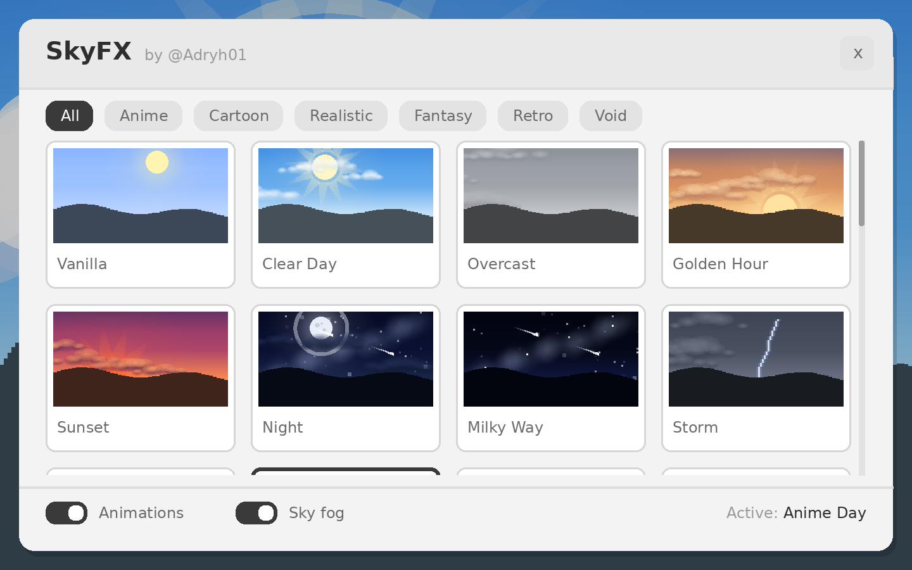

# SkyFX — by @Adryh01

Client-side Forge mod for **Minecraft 1.8.9**. Pick an animated custom sky from a clean white/grey menu with live previews.

## Skies (29) — by style
- **Realistic:** Vanilla, Clear Day, Overcast, Golden Hour, Sunset, Night, Milky Way, Storm (lightning), Aurora
- **Anime:** Anime Day, Anime Sunset (colours slowly shift), Anime Night, Sakura Dream (falling petals), Starfall (meteors)
- **Cartoon:** Cartoon Day, Cartoon Sunset, Cartoon Night, Candy — flat colour bands, outlined clouds, spiky suns
- **Fantasy:** Nebula, Blood Moon, Twin Moons, Toxic, Firefly Night
- **Retro:** Synthwave (scrolling grid), Vaporwave (colour cycling)
- **Void:** Void, Deep Void (pure black), Void Eclipse, Void Bloom

## What is animated
Drifting cloud puffs, twinkling and slowly rotating stars, milky way, aurora ribbons, shooting stars, sun rays and halo,
floating sparkles / petals / fireflies, lightning flashes, colour-cycling skies and a scrolling synthwave grid.
Everything is procedural (no textures). The fog takes the sky colour; skies with their own clouds hide the vanilla clouds.

## Use
- `/skyfx` opens the menu (also the **K** key, rebindable in Controls → SkyFX).
- `/skyfx <id>` sets a sky directly, `/skyfx list` lists the ids.
- Menu: style chips, click a card to apply, mouse wheel to scroll, toggles for **Animations** and **Sky fog**.
- Your choice is saved in `config/skyfx.cfg`.

## Install
1. Download `SkyFX-1.0.0.jar` (GitHub → Actions → latest run → Artifacts).
2. Put it in the `mods` folder of your 1.8.9 Forge profile.

> Lunar Client does not load Forge mods by itself. Use it with Forge 1.8.9 (official launcher / Prism / MultiMC).

## Add your own sky
Edit `src/main/resources/assets/skyfx/skies.json` — copy an entry and change it. Options:
`zenith / mid / horizon / bottom / fog`, `bands` (flat cartoon bands), `alt` + `cycle` (colour cycling),
`stars` (`shape: plus`), `milkyway`, `aurora`, `body` / `bodies` (sun, moon, crescent, eclipse; `rays`, `spikes`, `halo`),
`puffs` (cloud look), `meteors`, `particles` (sparkle / petal / firefly), `lightning`, `grid`.
`python3 tools/render_previews.py docs` redraws the previews.

## Build
Java 8 + Gradle 2.14.1 (ForgeGradle 2.1). The GitHub Action in `.github/workflows/build.yml` does it for you.
