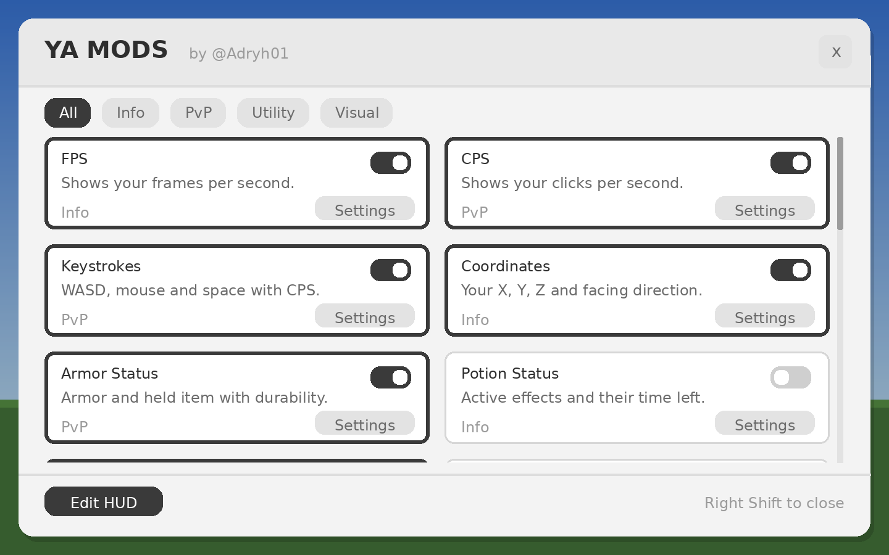

# YA MODS — by @Adryh01

Client-side Forge mod for **Minecraft 1.8.9**. It brings the YA CLIENT modules that exist in 1.8.9 into one white/grey menu.
Press **Right Shift** to open it. Every module has its own settings; HUD modules stack automatically on the left and can be moved with **Edit HUD**.

## Modules (111)
**Info** — FPS (colour by value), Coordinates, Ping, Clock, Potion Status, Speed, Direction, Session Time, Memory, Player Count, Server Address, Entity Count, Fall Distance, Health, Food, XP Level, XP Progress, Block Info, Item Info, Nearby Players, Nether Coords, Death Location, Day Counter, Light Level, Chunk Position, Target Distance, Sprint State, Game Mode, Look Angles, Distance Walked, Mount Speed, Breath, Mob Counter, Dropped Items, Session Stats

**PvP** — CPS, Keystrokes, Armor Status, Reach, Target HUD, Combo, Bow Charge, Potion/Gapple/Pearl/Arrow/Obsidian counters, Supplies, Crystals Nearby, Crystal Distance, Armor Value, Last Damage, Block State, Burning Alert, Armor Warning, Lag Warning, Gapples Eaten, Gapple Warning, Hit Timer, Hit Sparks, No FOV Effects, **Smooth Shift**, **1.7 Animations**, **Hit Hearts**, **Hitbox** (colour + colour when aiming), No Hurt Cam, **Hit Window**, **Throw Preview**, **Fight Recap**, **Hit Coach**, Hit Sounds, Kill Effects, Damage Popups, Target Gear

**Utility** — Toggle Sprint, Toggle Sneak, Zoom (C), FOV, FPS Boost, Unlimited FPS, VSync Off, Inventory HUD, Free Slots, XP Bottles, Held Item Count, Blocks Left, BedWars Resources / Items, Bucket Count, Firework Count, Hunger / Tool / Fall warnings, Hotbar Slot, **Scoreboard**, **Chat**, **Tab List** (move / resize the scoreboard and chat, remove their background), Chat Timestamps, Discord RPC (Windows)

**Visual** — Fullbright, Hide Fire, **Block Outline** (colour, thickness, fill), Time Changer, Clear Weather, Crosshair, Low Health, No Bobbing, No Clouds, No Screen Effects, Rainbow HUD, YA Trail

1.8.9 versions of YA CLIENT modules that need newer Minecraft: Totem Pops / Totem Warning became **Gapples Eaten / Gapple Warning**, Off Hand became **Hotbar Slot**, Hit Cooldown became **Hit Timer**.
Not possible in 1.8.9 (the items or mechanics do not exist): elytra, respawn anchors, auto jump. Cosmetics and the YA title / server screens are not part of this mod.

## Install
1. Download `YAMods-1.0.0.jar` (GitHub → Actions → latest run → Artifacts → YAMods).
2. Put it in the `mods` folder of your 1.8.9 Forge profile (works together with SkyFX).

> Lunar Client does not load Forge mods.

Settings are saved in `config/yamods.properties`: when you change them, every 30 seconds, when you leave a server or world, and when you close Minecraft. Keys: *Open YA MODS menu* (Right Shift) and *Zoom* (C) in Controls.

## Build
Java 8 + Gradle 2.14.1 (ForgeGradle 2.1). The GitHub Action does it for you.
